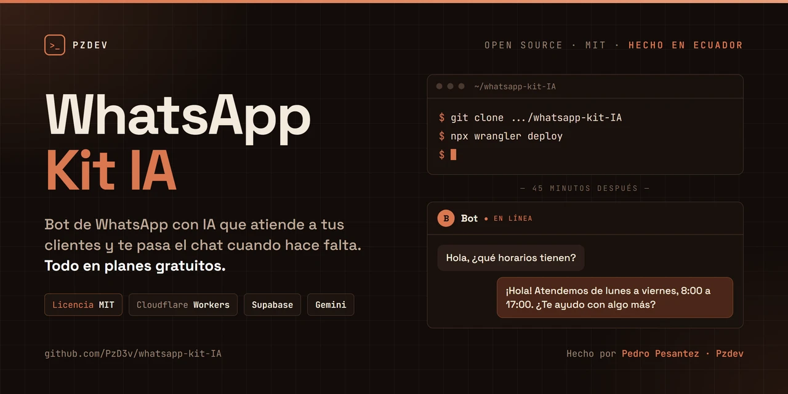

<p align="center">
  
</p>

<p align="center">
  <a href="https://github.com/PzD3v/whatsapp-kit-IA/stargazers"></a>
  <a href="LICENSE"></a>
  
  
  
  
</p>

<p align="center">
  <a href="#qué-hace"><b>Qué hace</b></a> ·
  <a href="#nuevo-cliente-en-6-pasos-unos-45-minutos">Inicio rápido</a> ·
  <a href="#día-a-día">Día a día</a> ·
  <a href="#avisos">Avisos</a>
</p>

# Plantilla: bot de WhatsApp con IA (Zernio + Gemini + Supabase + Cloudflare)

Bot que atiende WhatsApp con IA gratuita y deja que una persona tome el chat
desde el celular cuando haga falta (coexistencia). Todo en planes gratuitos.

## Qué hace

| Situación | Qué pasa |
|---|---|
| Pregunta normal | Responde la IA con la información de `src/negocio.js` |
| Pide una persona / quiere contratar / queja | Mensaje de traspaso; el chat pasa a modo humano |
| Manda foto, documento o audio | Mensaje de recibido; modo humano |
| Alguien del equipo responde desde el celular | Modo humano: el bot se calla en ese chat |
| Falla la IA (p. ej. cuota de Gemini) | Mensaje de espera; modo humano |
| `HUMANO_TIMEOUT_HORAS` sin actividad humana | Vuelve el bot |

## Nuevo cliente en 6 pasos (unos 45 minutos)

1. **Copia esta carpeta** con el nombre del cliente.
2. **Personaliza `src/negocio.js`:** reemplaza todo lo que está entre [CORCHETES].
3. **En `wrangler.toml`:** cambia `name` y `SUPABASE_URL`.
4. **Supabase:** crea un proyecto gratis y ejecuta `supabase/schema.sql` en el SQL Editor.
5. **Zernio:** conecta el WhatsApp del cliente (opción coexistencia + QR) y crea una API key.
6. **Publica:**
   ```
   npm install
   npm test
   npx wrangler login
   npm run deploy
   npx wrangler secret put LLM_API_KEY
   npx wrangler secret put SUPABASE_SERVICE_ROLE_KEY
   npx wrangler secret put ZERNIO_API_KEY
   npx wrangler secret put ZERNIO_WEBHOOK_SECRET
   npx wrangler secret put ADMIN_TOKEN
   ```
   Después crea el webhook en Zernio: URL `https://<tu-url>/webhook`, el mismo secret,
   eventos `message.received` y `message.sent`.

Abre `https://<tu-url>/`: debe decir `"status":"ok"` y `"faltan":[]`.

Para generar secretos aleatorios (WEBHOOK y ADMIN):
`node -e "console.log(require('crypto').randomBytes(24).toString('hex'))"`

## Archivos

| Archivo | ¿Lo tocas por cliente? | Para qué |
|---|---|---|
| `src/negocio.js` | **Sí** | Nombre, información, reglas y mensajes del negocio |
| `wrangler.toml` | **Sí** | Nombre del Worker y URL de Supabase |
| `src/knowledge.js` | No | Arma las instrucciones de la IA desde negocio.js |
| `src/index.js` | No | Decide quién responde |
| `src/zernio.js` | No | Firma, avisos y envío por Zernio |
| `src/llm.js` | No | Llamada a la IA (Gemini u otra compatible con OpenAI) |
| `src/db.js` | No | Memoria en Supabase (tablas `zc_*`) |
| `test/worker.test.mjs` | No | Prueba sin internet (`npm test`) |

## Día a día

- Chats en modo humano: `https://<tu-url>/admin/humano?token=<ADMIN_TOKEN>`
- Devolver un chat al bot: `https://<tu-url>/admin/bot?conversacion=<id>&token=<ADMIN_TOKEN>`
- Ver en vivo: `npm run logs`

## Avisos

- **Supabase gratis pausa el proyecto tras ~7 días sin uso.** Si pasa, entra al proyecto y pulsa Restore.
- **Gemini gratis** usa las conversaciones para mejorar sus productos. Avísalo al cliente y en sus políticas de privacidad.
- **Meta:** sin método de pago, el negocio solo puede **responder** (ventana de 24 h), no escribir primero. El bot no lo necesita.
- **Cambiar de IA:** `LLM_BASE_URL`, `LLM_MODEL` y `LLM_API_KEY` aceptan cualquier proveedor compatible con OpenAI.

Idea basada en [whatsapp-agentkit](https://github.com/Hainrixz/whatsapp-agentkit) (MIT, Enrique Rocha).

## Licencia

MIT © 2026 Pedro Pesantez - Pzdev. Ver [LICENSE](LICENSE).
